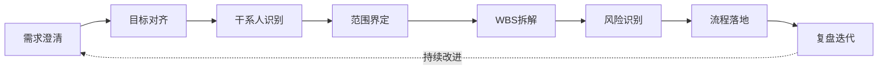
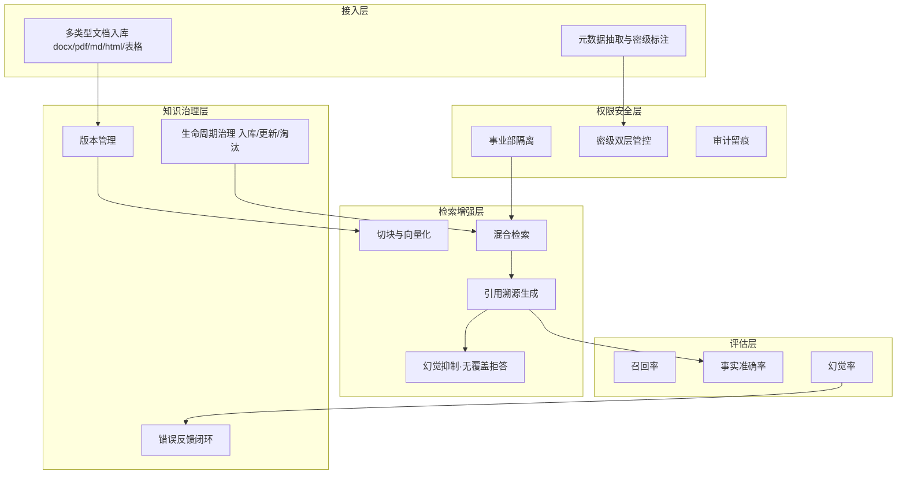

# 集团级统一 RAG 知识底座平台（GKB）

> **项目性质**：面向 **1000+ 人、多事业部并存**的集团级统一知识底座平台的一期 PMO 交付文档集。
> **本仓库定位**：PMO作品集。
> **展示重点**：项目管理、跨部门治理、风险管控思路，**而非算法调优**。

---

## 一、项目价值

集团知识以孤岛形式散落在各事业部，导致四大系统性痛点。本平台以「集团可信知识」统一对抗：

| # | 痛点 | 平台应对能力 | 对应文档 |
|---|---|---|---|
| P1 | 事业部文档归集阻力大 | 多类型文档入库 + 全生命周期治理 | `scope-statement.md`、`knowledge-governance-sop.md` |
| P2 | 文档版本冲突 | 版本管理 + 生效版本标记 | `scope-statement.md`、`knowledge-governance-sop.md` |
| P3 | 大模型幻觉致业务决策风险 | 引用溯源 + 无覆盖即拒答 + 效果评估 | `evaluation-plan.md`、`poc/demo.py` |
| P4 | 涉密文档泄露合规风险 | 事业部 + 密级双层隔离 + 审计留痕 | `risk-log.md`、`stakeholder-map.md` |

## 二、PM 思考链路（本作品集的组织主线）



每篇文档对应链路中的一环，形成从「拿到需求」到「复盘迭代」的完整闭环。

## 三、分层架构



## 四、项目角色说明

| 角色 | 职责 | 产出 |
|---|---|---|
| 项目发起人（CIO/CTO） | 战略背书、资源审批、跨事业部仲裁 | 最终决策 |
| **PMO 负责人（本人）** | 计划、进度、风险、跨部门治理、汇报 | 本仓库全部交付物 |
| 事业部接口人 | 文档归集、口径确认、验收 | 数据授权 |
| 信息安全/法务 | 权限模型、合规红线、数据分级 | 一票否决（合规项） |
| 技术负责人 | 架构、检索、评估落地 | 技术方案 |

## 五、仓库结构

```
enterprise-group-rag/
├── README.md                        # 本文档
├── feishu-wbs-import.csv            # WBS 任务清单
├── docs/
│   ├── project-charter.md           # 项目章程（干系人权力-利益矩阵）
│   ├── scope-statement.md           # 范围说明书（一期/二期边界）
│   ├── stakeholder-map.md           # 干系人地图 + 升级路径 + 8角色场景清单
│   ├── requirements.md              # 需求清单（业务/算法/安全/非功能）
│   ├── wbs-milestone.md             # WBS拆解 + 里程碑计划
│   ├── risk-log.md                  # 风险登记册（通用/半导体/新能源）+ 热力矩阵
│   ├── knowledge-governance-sop.md  # 知识全生命周期SOP（4条泳道图）
│   ├── evaluation-plan.md           # AI效果评估方案（召回/准确/幻觉率）
│   ├── industry-appendix.md         # 附录：半导体 + 新能源 专项适配
│   └── retrospective.md             # 项目复盘 + 迭代路线图
├── poc/
│   └── demo.py                      # 免依赖 PoC 脚本（验证链路）
└── assets/
    └── README.md                    # 演示截图说明
```

## 六、演示说明

`poc/demo.py` 为**免依赖演示桩**（纯标准库），验证端到端链路：

```bash
python -X utf8 poc/demo.py
```

脚本演示三个关键能力：

1. **权限隔离**：跨事业部文档（电芯配方、热失控参数）对半导体事业部用户**正确拒答**，越权访问率 = 0。
2. **幻觉抑制**：无知识覆盖的问题（量子退火）**正确拒答而非编造**。
3. **引用溯源**：可回答的问题均附带**文档来源锚点**。

运行截图见 `assets/demo-screenshot.png`。

## 七、行业可插拔适配

主体底座**通用、不绑定单一赛道**。半导体 / 新能源的差异内容作为**可插拔附录**独立承载：

- **附录 A（半导体）**：工艺参数密级、出口管制、数据不出域、IATF 追溯。
- **附录 B（新能源）**：配方 IP 保护、热失控安全参数零容忍、供应链时效、跨境合规。

启用对应行业版本时，仅追加管控点，**不改变主干基线**。详见 `docs/industry-appendix.md` 与 `docs/risk-log.md` 第 4/5 节。

## 八、快速导航

| 想了解 | 看这里 |
|---|---|
| 为什么做、目标、授权 | `docs/project-charter.md` |
| 做什么、不做什么、验收口径 | `docs/scope-statement.md` |
| 谁、看什么、升级路径、8角色 | `docs/stakeholder-map.md` |
| 四类需求 + 追溯 | `docs/requirements.md` |
| 怎么拆、何时交付 | `docs/wbs-milestone.md` |
| 有什么风险、怎么应对 | `docs/risk-log.md` |
| 知识怎么治理 | `docs/knowledge-governance-sop.md` |
| 效果怎么量化 | `docs/evaluation-plan.md` |
| 行业怎么差异化 | `docs/industry-appendix.md` |
| 怎么复盘、二期做什么 | `docs/retrospective.md` |
