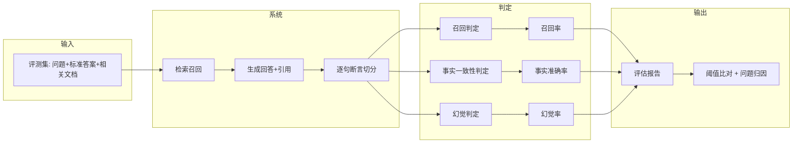
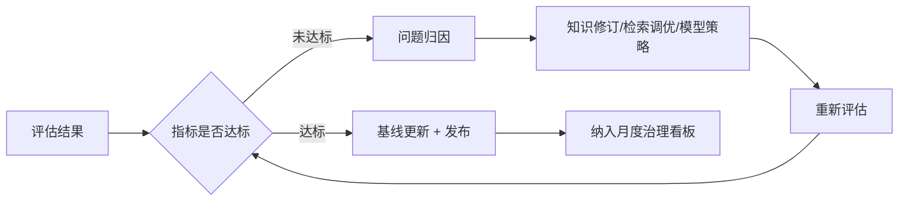

# AI 问答效果评估方案（Evaluation Plan）

> 项目代号：GKB · 关联：`requirements.md`（AR/S6）/ `risk-log.md`（R03/R07）
> 目标：让「好不好」可量化，用三个核心指标对抗「大模型幻觉」（痛点 P3）与「效果无法量化」（风险 R07）。

## 1. 评估指标体系

| 指标 | 定义 | 公式 | 一期达标阈值 |
|---|---|---|---|
| **召回率 Recall** | 相关知识片段是否被检索到 | 命中的相关片段数 / 相关片段总数 | ≥ 0.80 |
| **事实准确率 Accuracy** | 回答的事实陈述是否与知识源一致 | 一致的事实陈述数 / 事实陈述总数 | ≥ 0.90 |
| **幻觉率 Hallucination** | 回答中无知识源支撑的比例 | 无支撑陈述数 / 全部陈述数 | ≤ 0.05 |

**口径约定**
- **事实陈述**：由人工/LLM-Judge 对回答逐句切分为「可独立验证的断言」。
- **有支撑**：断言能在**引用来源片段**中找到语义等价的依据；找不到即记为无支撑（幻觉）。
- **拒答不算幻觉**：无知识覆盖时正确拒答，计入「安全拒答」，不计入幻觉。

## 2. 评估流水线

## 3. 评测集建设

| 维度 | 要求 |
|---|---|
| 来源 | 各事业部真实业务场景抽样，覆盖 8 类角色高频问题 |
| 规模 | 一期 ≥ 200 条，按知识域分层抽样 |
| 标注 | 每条含标准答案 + 相关文档 ID + 事实陈述标注 |
| 反例 | 刻意纳入「无知识覆盖」「跨事业部越权」「过期知识」三类陷阱题，验证拒答与隔离 |
| 刷新 | 每次知识库大版本更新后，抽取 20% 新样本滚动更新 |

## 4. 评估执行机制

- **评估时机**：每次知识库/模型/检索策略变更后回归评估；月度例行评估。
- **判定方式**：规则判定（引用命中）+ LLM-Judge（事实一致性）双通道，抽样 20% 人工复核校准。
- **报告**：输出三指标趋势 + 按知识域/角色的问题归因（知识过期/缺失/检索偏差/幻觉）。

## 5. 结果应用（闭环）

- 三指标与 `knowledge-governance-sop.md` 的反馈闭环联动：幻觉类问题反哺知识修订，检索偏差反哺检索策略。
- 评估结果作为「效果可量化」证据，纳入 `project-charter.md` 第 9 节成功标准汇报。
