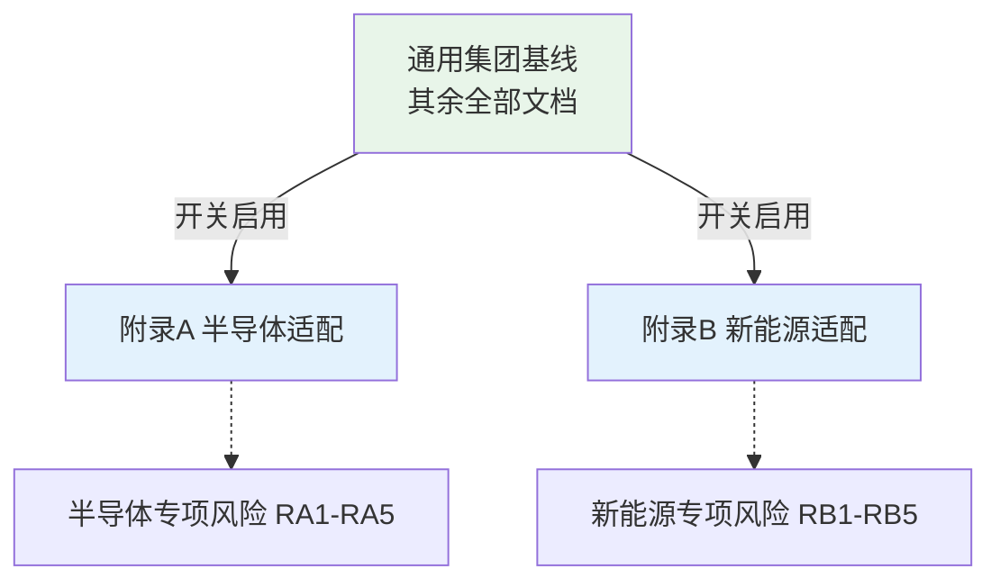
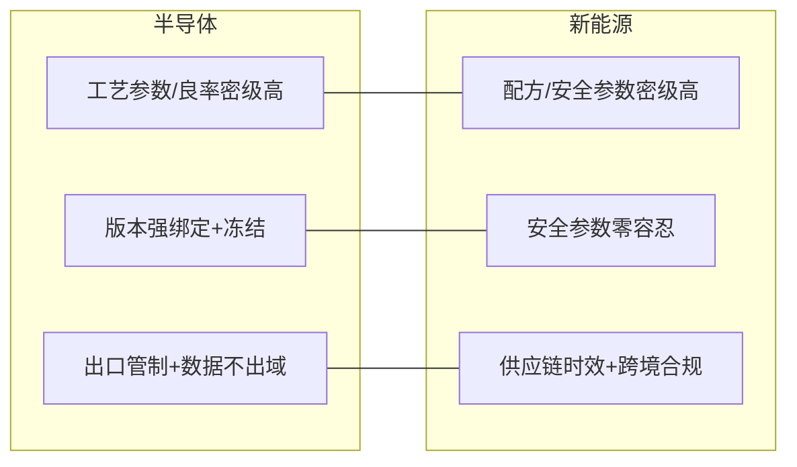

# 行业专项适配附录（Industry Appendix）

> 项目代号：GKB · 说明：本附录为**可插拔增强**，主干基线（其余文档）不绑定任何行业。面试/交付时按需启用对应行业版本，主体底座无需改动。
> 关联：`risk-log.md` 第 4/5 节（行业专项风险 RA/RB）。

## 0. 通用基线与行业适配的关系

- 启用规则：某事业部接入时，若属半导体/新能源赛道，则叠加对应附录的**知识类型、质量管控、合规要点、专项风险**。
- 互不干扰：附录只**追加**约束，不修改主干流程；未启用时附录字段不进入验收。

---

# 附录 A：半导体行业专项适配规则

## A.1 专属知识类型

| 类型 | 说明 | 密级默认 |
|---|---|---|
| 工艺配方 / 参数 | 光刻、刻蚀、薄膜、掺杂等工艺参数 | 最高密级 |
| 良率分析报告 | Yield 分析、缺陷图谱、失效分析 | 高密级 |
| 设备操作规程 | 机台 SOP、维护规范 | 高密级 |
| 设计规则 / PDK | 工艺设计套件与设计规则 | 最高密级 |
| 质量体系文件 | IATF 16949 / ISO 相关 | 中密级 |

## A.2 特殊质量管控要求

- **版本强绑定**：工艺参数类知识必须与「生效版本 + 变更记录 + 审批链」强制关联，过期参数**自动冻结**而非仅降权（对应 RA2）。
- **双重确认**：涉及量产的关键参数，更新须 Owner + 质量双签。
- **追溯性**：知识对象须可回溯至质量体系要求的变更单（ECN/PCN），满足 IATF 追溯。

## A.3 特有风险与合规管控要点

| 要点 | 管控要求 | 关联风险 |
|---|---|---|
| 出口管制（EAR） | 受控技术/数据入库前出口管制合规审查 | RA1 |
| 数据不出域 | Fab 环境本地化部署 + 网络隔离，禁止数据出境 | RA3 |
| NDA 边界 | 供应商/客户知识共享边界映射 + 会签 | RA4 |
| 工艺时效 | 变更即更新，过期即下线，时效标记强制 | RA2 |

---

# 附录 B：新能源行业专项适配规则

## B.1 专属知识类型

| 类型 | 说明 | 密级默认 |
|---|---|---|
| 电芯配方 / 化学体系 | 正负极、电解液配方 | 最高密级 |
| 安全 / 热失控相关 | 热管理、安全阈值、应急规程 | 最高密级 |
| 工艺参数 | 涂布、卷绕、化成等参数 | 高密级 |
| 供应链 / 供应商 | 材料规格、供应商准入、替代料 | 高密级 |
| 生产安全规程 | 危化品、高压、电池仓储安全 | 最高密级 |

## B.2 特殊质量与安全管控要求

- **安全类参数最高优先级审校**：涉及电池安全/热失控的参数错误后果为安全事故，须**双重确认 + 失效即冻结**（对应 RB1）。
- **供应链时效**：材料/供应商知识频繁失效，须时效标记 + 失效自动提示 + 快速更新通道（对应 RB2）。
- **规程一致性**：安全规程与现场 SOP 强制一致，定期核验，杜绝「文档一套、现场一套」（对应 RB5）。

## B.3 特有风险与合规管控要点

| 要点 | 管控要求 | 关联风险 |
|---|---|---|
| 配方 IP 保护 | 配方类最高密级 + 最小化授权 + 水印溯源 | RB3 |
| 数据跨境 | 多基地分地区合规矩阵 + 数据本地化 | RB4 |
| 安全事故防控 | 安全参数错误零容忍，审校与冻结机制 | RB1 |

---

## 附录对比总览

