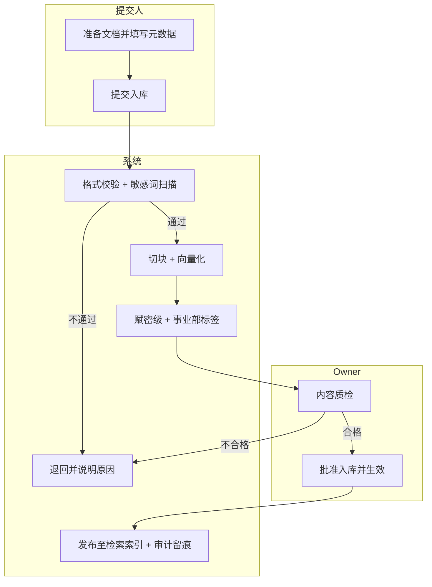
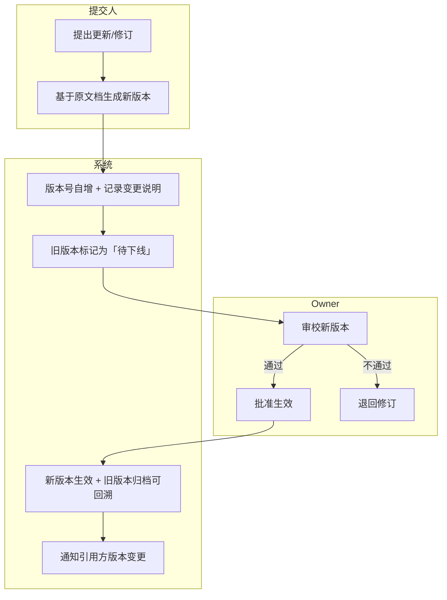
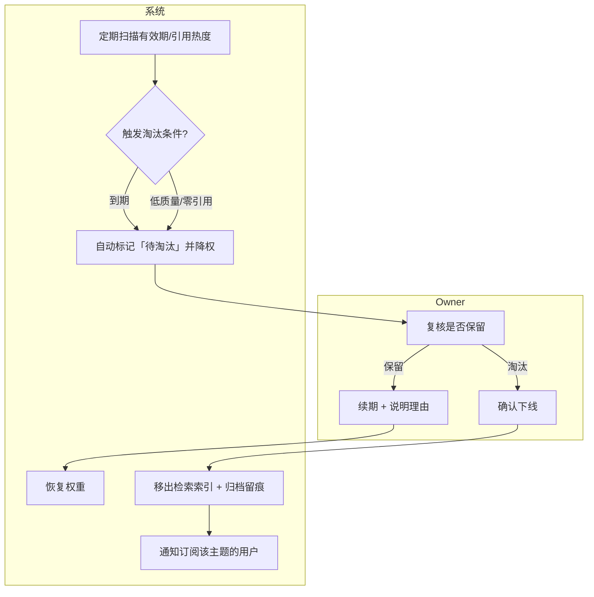
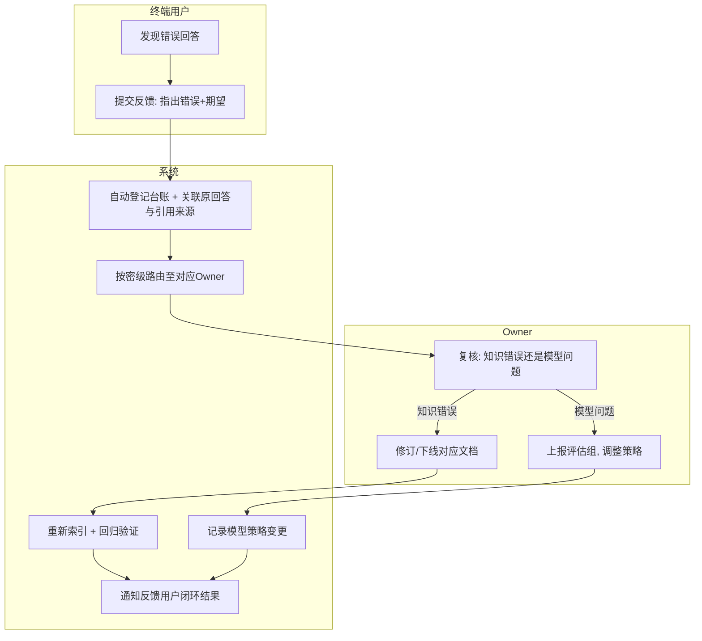

# 知识全生命周期治理 SOP（Knowledge Governance SOP）

> 项目代号：GKB · 关联：`scope-statement.md`（S5）/ `risk-log.md`（R01/R02/R06/R08）
> 覆盖四条主线：**入库 → 更新 → 过期淘汰 → 错误反馈闭环**。每条 SOP 配泳道流程图，明确「谁在何时做什么」。

## 0. 通用角色泳道说明

所有 SOP 共享以下泳道角色：

| 泳道 | 角色 | 职责 |
|---|---|---|
| 提交人 | 各事业部员工 | 提交/反馈知识 |
| 知识 Owner | 各事业部知识负责人 | 内容审校、质量把关 |
| PMO/治理组 | 平台治理组织 | 流程合规、跨部门协调 |
| 系统 | 平台自动化能力 | 校验、标记、降权、留痕 |

## 1. 知识入库 SOP

- **质检要点**：来源明确、无过期内容、无涉密越级、格式合规。
- **SLA**：Owner 审校 ≤ 2 个工作日；未处理自动提醒。

## 2. 知识更新 SOP

- **版本规则**：`主版本.次版本`，重大变更升主版本，修订升次版本。
- **冲突处理**：同一主题多源矛盾时，由 Owner 仲裁并标记唯一「生效版本」（对应风险 R02）。

## 3. 知识过期淘汰 SOP

- **淘汰条件**：超过有效期、长期零引用且无更新、被判定为过时/错误。
- **安全类/工艺类知识**：行业专项要求见 `industry-appendix.md`（如参数失效即冻结）。

## 4. 错误回答反馈闭环 SOP

> 直接对抗痛点 P3（幻觉），是「AI 回答效果」与「知识质量」的反馈回路。

- **闭环 KPI**：闭环率 ≥ 95%（对应 S7）。
- **台账字段**：反馈内容、来源回答、根因分类、处理动作、处理人、闭环时间。
- **根因分类**：知识过期 / 知识缺失 / 知识错误 / 检索偏差 / 模型幻觉——用于反向驱动治理（对应风险 R08）。

## 5. 治理组织与运行节奏

| 机制 | 频率 | 内容 |
|---|---|---|
| 知识 Owner 例会 | 双周 | 质量问题、积压审校、淘汰复核 |
| 治理数据看板 | 周 | 入库量、更新量、淘汰量、闭环率、幻觉率 |
| 季度治理回顾 | 季 | 治理策略调整、Owner 责任重分配、行业细则启用评估 |
