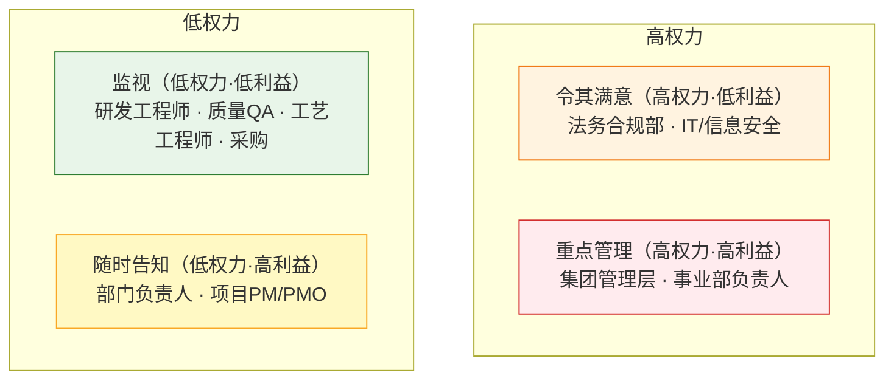
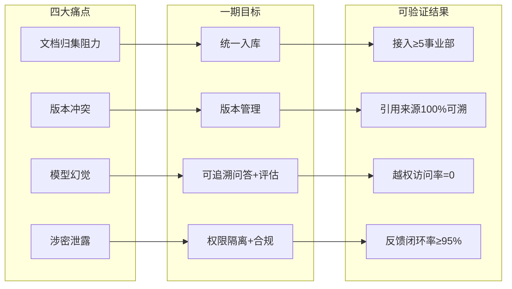
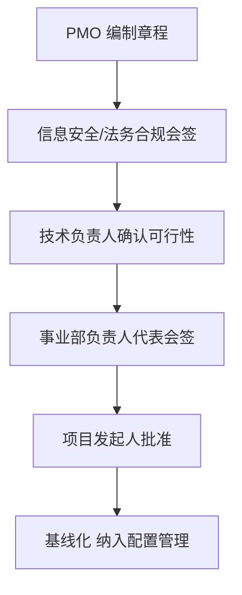

# 项目章程（Project Charter）

> 项目代号：**GKB（Group Knowledge Base）** · 版本 v1.0 · 编制人：PMO 负责人 · 状态：已批准
> 本文档是项目的授权依据，明确「为什么做、做到什么程度、谁有权决策、哪些不能做」。后续所有范围、计划、风险文档均以本章程为准。

## 1. 项目背景与问题陈述

集团现有员工 **1000 人以上**，多事业部并行运作。知识以孤岛形式散落在各事业部的本地盘、IM 群、邮件与个人电脑中，导致四类系统性痛点：

| # | 痛点 | 业务后果 |
|---|---|---|
| P1 | 事业部文档归集阻力大 | 知识无法复用，重复造轮子，新人上手周期长 |
| P2 | 文档版本冲突 | 同一主题存在多份矛盾版本，执行口径不一 |
| P3 | 大模型幻觉 | 直接问通用大模型可能得到编造的「参数/规范」，误导业务决策 |
| P4 | 涉密文档泄露风险 | 无统一权限隔离，内部敏感文档存在越权暴露与对外泄露合规风险 |

本章程授权启动 **集团级统一 RAG 知识底座平台**，以「集团可信知识」对抗上述痛点。

## 2. 项目目标（SMART）

| 维度 | 目标（一期验收口径） |
|---|---|
| 覆盖 | 接入集团 **≥ 5 个事业部** 的文档库，完成多类型文档入库 |
| 能力 | 提供**向量检索问答**，回答附带**可追溯引用来源** |
| 隔离 | 实现**事业部级数据权限隔离**，跨域越权访问率为 **0** |
| 治理 | 文档版本可管理，知识全生命周期（入库→更新→过期→下线）闭环 |
| 质量 | 建立 **AI 回答效果评估体系**，幻觉率、事实准确率可量化 |
| 反馈 | 用户错误回答可反馈并闭环处理，闭环率 ≥ 95% |
| 时间 | 一期里程碑见 `wbs-milestone.md`，整体按 4 个冲刺节奏推进 |

> 说明：本作品集聚焦**项目管理与跨部门治理**的展示，目标均以「可交付、可验证」为口径，不涉及算法指标调优。

## 3. 范围边界（高层）

- **一期纳入**：多类型文档入库、向量检索问答、事业部权限隔离、版本管理、知识全生命周期治理、AI 效果评估、错误反馈闭环。
- **一期排除**：自研大模型、批量扫描件 OCR、对外客户访问入口、复杂 BI 报表（详见 `scope-statement.md` 的完整清单与边界图）。

## 4. 干系人权力—利益矩阵

干系人管理策略按其「权力」与「利益」定位，决定管理投入强度。**高权力高利益**为核心干系人，需重点管理；**高权力低利益**需令其满意；**低权力高利益**需随时告知；**低权力低利益**仅需监视。

> 矩阵读法：横轴 = 利益（左低右高），纵轴 = 权力（上高下低）。

> 完整干系人登记、RACI 与 8 类角色场景清单见 `stakeholder-map.md`。

## 5. 目标对齐（目标—关键结果—痛点映射）

## 6. 角色与授权

| 角色 | 责任 | 授权 |
|---|---|---|
| 项目发起人（集团 CIO/CTO） | 战略背书、资源审批、跨事业部冲突仲裁 | 最终决策权 |
| PMO 负责人（本人） | 计划、进度、风险、跨部门治理、汇报 | 日常管理权 |
| 事业部接口人 | 本事业部文档归集、口径确认、验收 | 本事业部数据授权 |
| 信息安全 / 法务 | 权限模型、合规红线、数据分级 | 一票否决权（合规项） |
| 技术负责人 | 架构、检索、评估体系落地 | 技术方案决策 |

## 7. 约束与假设

**约束**
- 一期**不自研大模型**，采用成熟大模型 + RAG 检索增强路线。
- 涉密文档必须**事业部级 + 密级双维度**隔离，合规要求不因工期妥协。
- 数据不出集团内网（半导体行业专项需满足「数据不出域」，见 `industry-appendix.md`）。

**假设**
- 各事业部具备可提取的存量文档（≥ 一定规模）作为冷启动语料。
- 基础设施可支撑向量库与检索服务部署。
- 各事业部指派接口人并投入归集时间。

## 8. 审批链

## 9. 成功标准（Definition of Success）

1. 一期范围内 7 项能力**全部上线且通过验收**（见 `scope-statement.md`）。
2. 四大痛点各有一条**可量化缓解指标**并纳入月度汇报。
3. 建立**可持续运营的治理组织与 SOP**（见 `knowledge-governance-sop.md`），而非一次性交付。
4. 用户侧形成正向使用率，**反馈闭环持续运转**。
