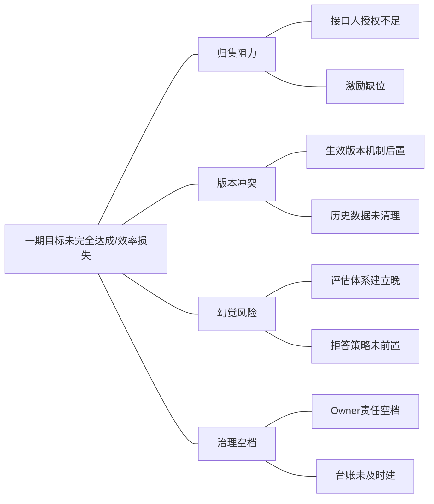
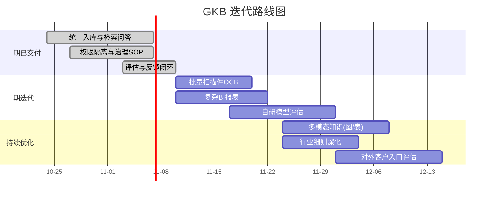

# 项目复盘与迭代路线图（Retrospective）

> 项目代号：GKB · 关联：全部文档
> 复盘聚焦「过程可改进项」而非成果罗列，产出可落地的迭代路线图。

## 1. 复盘结论速览

| 维度 | 做得好（保留） | 做得不足（改进） |
|---|---|---|
| 需求澄清 | 一期范围 7 项边界清晰，排除项显式入 backlog | 行业差异识别偏晚，未在立项期预置「可插拔」机制 |
| 干系人 | 8 类角色场景全覆盖，权限边界明确 | 事业部负责人攻坚启动偏慢，早期归集阻力低估 |
| 范围 | CCB 变更控制有效遏制蔓延 | 初期对「效果量化」验收口径定义过晚 |
| 风险 | 通用/行业三类风险分层清晰，热力矩阵可视化 | 行业专项风险（RA/RB）未在立项期即纳入评估 |
| 流程 | 4 条 SOP 泳道图明确责任 | 反馈闭环的 Owner 责任在初期存在空档 |

## 2. 改进项因果图（鱼骨图）

## 3. 关键教训

1. **行业差异化要前置**：多事业部并存时，行业特殊管控点应在**立项期**识别，以「可插拔附录」承载，避免后期返工（本期已在 `industry-appendix.md` 落地）。
2. **效果量化要早**：评估体系若后置，会导致「做得对不对」无法在中途验证。应把评估集与验收口径前移到 M1 之后。
3. **治理责任要实**：知识 Owner 是治理的「最后一公里」，须在干系人阶段就明确授权与考核，而非流程上线后补。
4. **拒答优于强答**：在可信度不足的场景，正确拒答的体验优于编造回答——这是对抗幻觉的底线设计。

## 4. 后续迭代路线图

## 5. 二期 backlog 优先级（承接 `scope-statement.md` 排除项）

| 优先级 | 事项 | 来源 |
|---|---|---|
| P0 | 批量扫描件 OCR | 排除项 X2（存量纸质/扫描文档是最大未覆盖源） |
| P0 | 复杂 BI 报表 | 排除项 X4（管理层决策诉求） |
| P1 | 自研模型评估 | 排除项 X1（降本与可控性评估） |
| P1 | 对外客户访问入口 | 排除项 X3（商业化扩展） |
| P2 | 多模态知识（图片/表格理解） | 新需求 |

## 6. 复盘机制

- **复盘节奏**：每个里程碑结束 + 项目整体结束各一次。
- **产出**：改进项清单 → 责任人 → 截止日 → 纳入下期 backlog。
- **沉淀**：本复盘与 `feishu-wbs-import.csv` 的「复盘迭代」阶段任务对应，形成「计划—执行—复盘」闭环。
