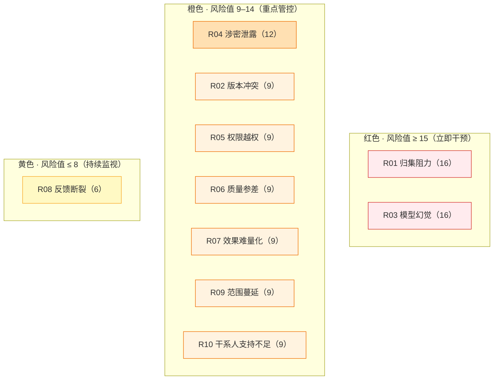

# 风险登记册（Risk Register）

> 项目代号：GKB · 版本 v1.0 · 关联：`project-charter.md`（痛点）/ `requirements.md`（追溯矩阵）
> 本项目核心亮点文档。风险分三类管理：**通用风险（R）**、**半导体专项风险（RA）**、**新能源专项风险（RB）**——行业风险仅在启用对应行业版本时激活，不污染通用基线。

## 1. 风险评估口径

- **概率 P**：1（低）– 5（高）
- **影响 I**：1（低）– 5（高）
- **风险值 = P × I**：≥ 15 红色（需立即干预）、9–14 橙色（重点管控）、≤ 8 黄色（持续监视）
- **应对策略**：规避 / 缓解 / 转移 / 接受

## 2. 风险热力矩阵

> 风险值 = 概率 × 影响（见第 3 节登记表）；红色 ≥ 15 立即干预，橙色 9–14 重点管控，黄色 ≤ 8 持续监视。行业专项风险（RA/RB）的热力分级见第 4/5 节。

## 3. 通用风险登记表

| ID | 风险 | 概率 | 影响 | 值 | 应对 | 缓解措施 | 触发信号 | 责任人 |
|---|---|---|---|---|---|---|---|---|
| R01 | 事业部文档归集阻力大，冷启动失败 | 4 | 4 | 16 | 缓解 | 逐事业部攻坚、设接口人、明确数据授权与激励 | 归集进度连续 2 周不达标 | PMO |
| R02 | 文档版本冲突、检索到过期/矛盾内容 | 3 | 3 | 9 | 缓解 | 版本管理 + 生效版本标记 + 过期自动降权 | 出现同一主题矛盾回答 | 技术 |
| R03 | 大模型幻觉致业务决策风险 | 4 | 4 | 16 | 缓解 | 引用溯源 + 无知识覆盖即拒答 + 效果评估体系 | 幻觉率超阈值 | 技术+PMO |
| R04 | 涉密文档泄露合规风险 | 4 | 3 | 12 | 规避/缓解 | 事业部+密级双层隔离、脱敏、审计留痕 | 出现越权/外泄事件 | 信息安全/法务 |
| R05 | 权限隔离失效、跨事业部越权 | 3 | 3 | 9 | 规避 | 权限过滤器 + 自动化越权回归测试 | 回归测试失败 | 信息安全 |
| R06 | 知识质量参差、低质文档污染检索 | 3 | 3 | 9 | 缓解 | 入库质检 + 生命周期治理 + 淘汰机制 | 低质文档占比上升 | PMO |
| R07 | 效果无法量化、难说服管理层 | 3 | 3 | 9 | 规避 | 提前建评估体系与基线指标 | 汇报缺量化指标 | PMO |
| R08 | 反馈闭环断裂、错误持续存在 | 2 | 3 | 6 | 缓解 | 反馈闭环 SOP + 台账 + 闭环率 KPI | 闭环率下降 | PMO |
| R09 | 范围蔓延、二期内容提前进入致延期 | 3 | 3 | 9 | 规避 | 一期 7 项基线 + CCB 变更控制 | 新需求绕过变更流程 | PMO |
| R10 | 关键干系人（事业部负责人）支持不足 | 3 | 3 | 9 | 缓解 | 高层背书 + 一对一攻坚 + 价值证明 | 会签拖延/拒绝 | 发起人 |

## 4. 半导体行业专项风险（RA）

> 启用「半导体行业适配细则」（`industry-appendix.md` 附录 A）时激活。

| ID | 风险 | 概率 | 影响 | 值 | 应对 | 缓解措施 |
|---|---|---|---|---|---|---|
| RA1 | 工艺参数/良率数据涉密等级高，泄露后果严重（含出口管制） | 4 | 5 | 20 | 规避 | 最高密级 + 数据不出域 + 出口管制合规审查 |
| RA2 | 工艺变更频繁，知识时效性极强，过期参数误导生产 | 4 | 4 | 16 | 缓解 | 生效版本强绑定 + 变更记录 + 过期强制下线 |
| RA3 | Fab 环境信息安全等级隔离，数据不出域硬约束 | 3 | 5 | 15 | 规避 | 本地化部署 + 网络隔离 + 专项安全评估 |
| RA4 | 供应商/客户 NDA 约束知识共享边界 | 3 | 4 | 12 | 规避 | 知识共享边界映射 + NDA 合规会签 |
| RA5 | 质量体系（IATF/ISO）追溯要求，知识须与版本/变更强绑定 | 3 | 4 | 12 | 规避 | 知识对象与版本、变更记录、审批链强制关联 |

## 5. 新能源行业专项风险（RB）

> 启用「新能源行业适配细则」（`industry-appendix.md` 附录 B）时激活。

| ID | 风险 | 概率 | 影响 | 值 | 应对 | 缓解措施 |
|---|---|---|---|---|---|---|
| RB1 | 电池安全/热失控相关参数错误导致安全事故 | 3 | 5 | 15 | 规避 | 安全类参数双重确认 + 高优先级审校 + 失效即冻结 |
| RB2 | 供应链波动大，材料/供应商知识频繁失效 | 4 | 3 | 12 | 缓解 | 供应商知识时效标记 + 失效自动提示 + 快速更新通道 |
| RB3 | 化学配方/工艺知识产权泄露风险 | 3 | 4 | 12 | 规避 | 配方类最高密级 + 最小化授权 + 水印溯源 |
| RB4 | 多基地（全球）合规差异、数据跨境约束 | 3 | 4 | 12 | 规避 | 分地区合规矩阵 + 数据本地化部署 |
| RB5 | 生产安全（危化品/高压）规程与现场执行不一致 | 3 | 4 | 12 | 规避 | 安全规程版本与现场 SOP 强制一致 + 定期核验 |

## 6. 风险应对与汇报机制

- **风险评审**：每周风险例会，更新 P/I/应对状态。
- **阈值升级**：风险值 ≥ 15 或出现「触发信号」立即上报 CCB。
- **闭环**：每条风险须有责任人与截止日，缓解措施落地后降级或关闭。
- **与需求联动**：风险与需求追溯见 `requirements.md` 第 6 节，确保风险有对应缓解能力兜底。
