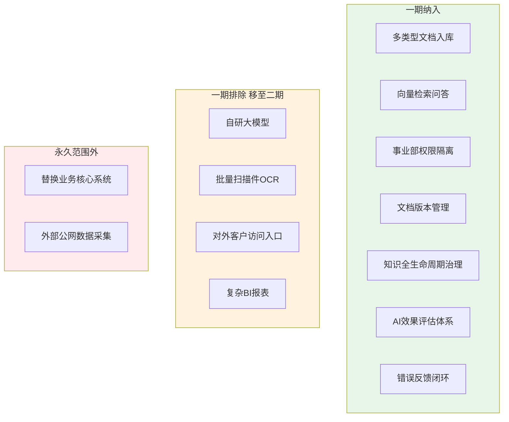
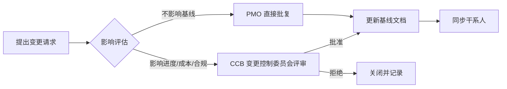

# 范围说明书（Scope Statement）

> 项目代号：GKB · 版本 v1.0 · 关联：`project-charter.md` / `wbs-milestone.md`
> 本文档定义「做什么、不做什么、做到什么程度算验收」，是变更管理（第 5 节）与验收（第 4 节）的唯一依据。

## 1. 范围边界图

## 2. 一期纳入清单（含验收口径）

| 编号 | 交付能力 | 范围描述 | 验收标准（DoD） |
|---|---|---|---|
| S1 | 多类型文档入库 | docx / pdf / markdown / html / 表格等结构化入库，抽取正文与元数据 | 支持 ≥ 5 种格式；入库成功率 ≥ 99%；元数据完整 |
| S2 | 向量检索问答 | 基于向量相似度检索 + 大模型生成回答 | 回答**必须附引用来源**；来源可追溯率 100% |
| S3 | 事业部权限隔离 | 按事业部 + 密级双层隔离检索范围 | 跨域越权访问率 = 0（自动化回归验证） |
| S4 | 文档版本管理 | 版本编号、变更记录、历史可回溯 | 任意文档可回溯历史版本；冲突版本可标记 |
| S5 | 知识全生命周期治理 | 入库→更新→过期淘汰→下线全流程（见 SOP） | SOP 覆盖 4 条主线；过期文档自动标记 |
| S6 | AI 效果评估体系 | 召回率 / 事实准确率 / 幻觉率评估（见 `evaluation-plan.md`） | 评估流水线可运行；指标口径固化 |
| S7 | 错误回答反馈闭环 | 用户对错误回答反馈→人工复核→知识修订（见 SOP） | 反馈闭环率 ≥ 95%；有闭环台账 |

## 3. 一期排除清单（移至二期迭代，不在一期承诺）

| 编号 | 排除项 | 排除理由 | 预期二期时间 |
|---|---|---|---|
| X1 | 自研大模型 | 一期聚焦治理与检索，模型用成熟方案，避免摊薄精力 | 二期评估 |
| X2 | 批量扫描件 OCR | 扫描件识别属独立工程，与核心链路解耦 | 二期迭代 |
| X3 | 对外客户访问入口 | 一期仅对内，规避对外合规与安全面 | 二期评估 |
| X4 | 复杂 BI 报表 | 决策分析非知识底座核心，避免范围蔓延 | 二期/并行项目 |

> 排除不等于不做，而是**显式放入二期 backlog**，防止一期范围蔓延（对应风险 R09）。

## 4. 验收标准（整体）

1. S1–S7 全部满足各自 DoD。
2. 通过 `evaluation-plan.md` 定义的**一期评测集**（召回率、事实准确率、幻觉率达标阈值）。
3. 权限隔离通过**越权访问自动化回归**。
4. 治理 SOP 已运行 ≥ 1 个完整周期（含一次过期淘汰 + 一次错误反馈闭环）。

## 5. 变更管理（Scope Change Control）

任何范围变更（新增能力 / 提前纳入排除项 / 调整验收口径）须走变更流程：

- **CCB 成员**：项目发起人、PMO 负责人、信息安全/法务代表、技术负责人。
- **基线文档**：本章程、`project-charter.md`、`wbs-milestone.md` 任何变更须留痕。

## 6. 范围控制要点

- 以「一期 7 项」为**不可自动扩张**的承诺；新增需求一律进入 backlog 排序，不挤占一期节奏。
- 行业专项（半导体 / 新能源）作为**可插拔适配细则**挂接在 `industry-appendix.md`，**不改变主体基线范围**，仅在启用对应行业版本时追加管控点。
- 每周对照 WBS 做一次**范围偏差检查**，超 10% 工作量偏差即触发变更评估。
