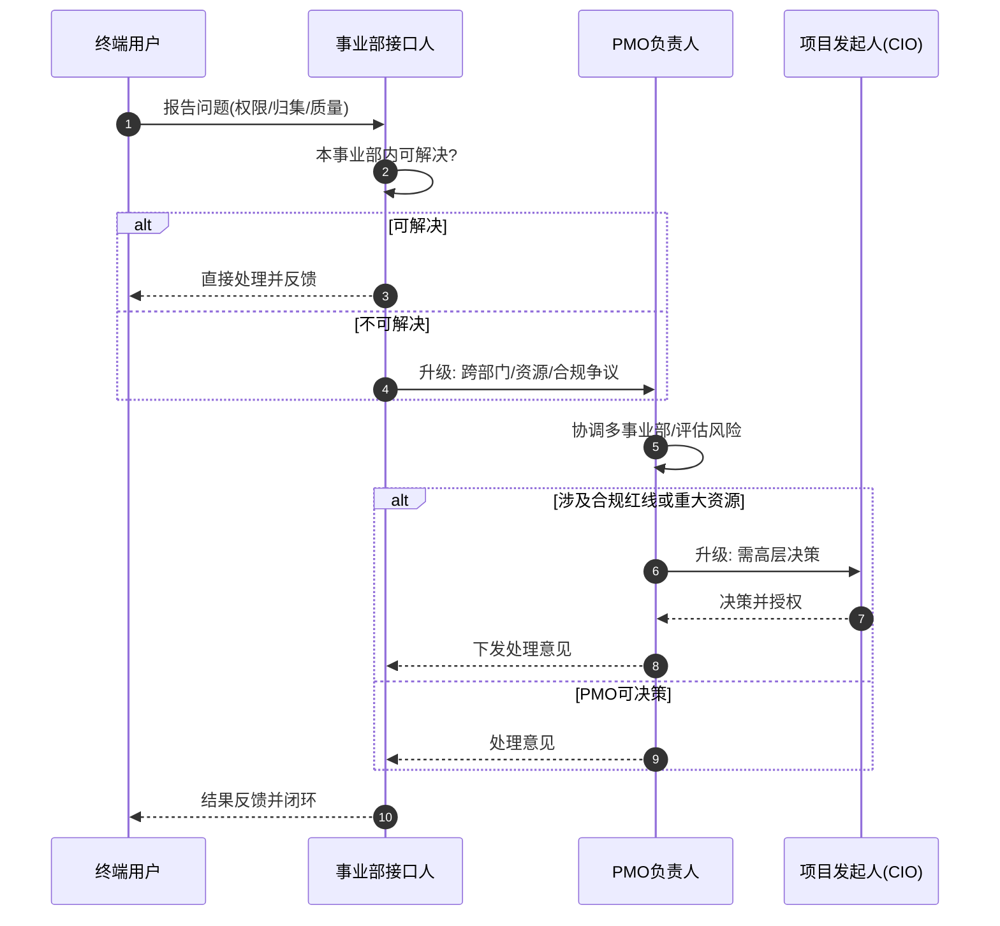

# 干系人地图与角色场景清单（Stakeholder Map）

> 项目代号：GKB · 关联：`project-charter.md`（权力—利益矩阵）
> 本文档是跨部门治理的核心：识别**谁**、关心**什么**、能**看什么**、有什么**风险**，并给出升级路径。

## 1. 干系人登记册

| ID | 干系人 | 角色定位 | 权力 | 利益 | 管理策略 |
|---|---|---|---|---|---|
| S1 | 集团管理层 | 发起人/决策 | 高 | 高 | 重点管理，月度汇报 |
| S2 | 事业部负责人 | 数据主人/资源 | 高 | 高 | 重点管理，逐事业部攻坚 |
| S3 | 法务合规部 | 合规红线 | 高 | 中 | 令其满意，一票否决 |
| S4 | IT/信息安全 | 基础设施/权限 | 高 | 中 | 令其满意，权限模型共建 |
| S5 | 部门负责人 | 使用方/推广 | 中 | 高 | 随时告知，驱动落地 |
| S6 | 项目 PM/PMO | 使用方/同行 | 中 | 高 | 随时告知，共建方法论 |
| S7 | 研发/QA/工艺/采购 | 终端用户 | 低 | 中 | 收集反馈，高频触达 |

## 2. 升级路径泳道图

问题在不同层级可被解决时，沿泳道逐级升级，避免「卡在中间层」。

## 3. 分角色场景清单（8 类角色全覆盖）

> 每类角色从**查询场景 / 使用诉求 / 权限边界 / 高频风险点**四维度梳理，确保无遗漏。权限边界遵循「事业部 + 密级」双层模型。

| 角色 | 典型查询场景 | 核心使用诉求 | 权限边界 | 高频风险点 |
|---|---|---|---|---|
| **研发工程师** | 历史技术方案、组件用法、接口文档、故障复盘、新人上手资料 | 快速复用、避免重复造轮子、缩短上手周期 | 本事业部 + 集团公共知识；不可见其他事业部在研项目 | 检索到过期方案；跨事业部复用引入未授权依赖 |
| **质量 QA** | 质量规范、测试用例库、缺陷模式库、客户投诉历史、质量体系文件 | 统一判标口径、追溯缺陷根因、复用用例 | 集团质量体系文件 + 本事业部项目质量记录 | 规范版本不一致导致误判；引用已作废文件 |
| **工艺工程师** | 工艺参数、工艺变更记录、设备操作规程、良率分析报告 | 获取**当前有效**工艺参数，杜绝用错版本 | 本事业部/本工厂工艺文件；参数密级高 | 用错工艺版本致生产事故；参数类幻觉（行业专项见附录） |
| **采购** | 供应商准入标准、采购制度、物料规格、合同模板、供应商历史表现 | 快速查准入与合规要求、规格一致性 | 采购制度 + 授权供应商数据；商务条款脱敏 | 供应商黑名单/商务价格外泄 |
| **法务合规** | 合同模板、法规清单、合规制度、出口管制/数据合规要求 | 统一合规口径、支撑审查 | 全集团法规制度库；案件档案高权限 | 过期模板误用；涉密法律意见泄露；跨境合规 |
| **项目 PM/PMO** | 项目模板、方法论、历史复盘、风险清单、里程碑经验 | 复用管理资产、对齐跨部门流程 | 集团 PMO 方法论 + 所辖项目文档 | 引用历史项目敏感数据；方法论版本混乱 |
| **部门负责人** | 部门 KPI/能力地图、资源规划、知识沉淀盘点、跨部门最佳实践 | 看清部门知识资产与缺口、决策支持 | 本部门全部 + 集团经营分析摘要 | 跨部门经营数据越权；知识缺口被掩盖 |
| **集团管理层** | 集团经营数据、战略文件、重大决策依据、跨事业部对标 | 全局视角决策、验证数据口径一致性 | 集团级汇总（脱敏）；不可下钻个人/项目明细 | 汇总口径不一致误导决策；越权下钻明细 |

## 4. 干系人 RACI 矩阵（关键活动）

| 活动 | 发起人 | PMO | 事业部接口人 | 信息安全/法务 | 技术负责人 | 终端用户 |
|---|---|---|---|---|---|---|
| 章程与目标 | A | R | C | C | C | I |
| 文档归集 | — | A | R | C | I | C |
| 权限模型 | I | C | C | A/R | R | I |
| SOP 制定 | — | A/R | C | C | C | C |
| 评估体系 | — | A | I | C | R | C |
| 验收 | A | R | C | C | R | C |
| 反馈闭环 | I | A | R | C | I | C |

## 5. 干系人管理节奏

| 干系人 | 触达方式 | 频率 | 关键议程 |
|---|---|---|---|
| 集团管理层 | 月度汇报 + 里程碑决策会 | 月 | 进度、风险、需决策项 |
| 事业部负责人 | 一对一攻坚会 | 双周 | 归集阻力、数据授权、验收 |
| 信息安全/法务 | 合规会签 | 按里程碑 | 权限模型、密级、合规红线 |
| 终端用户 | 内测反馈 + 使用问卷 | 持续 | 场景覆盖、错误反馈 |
