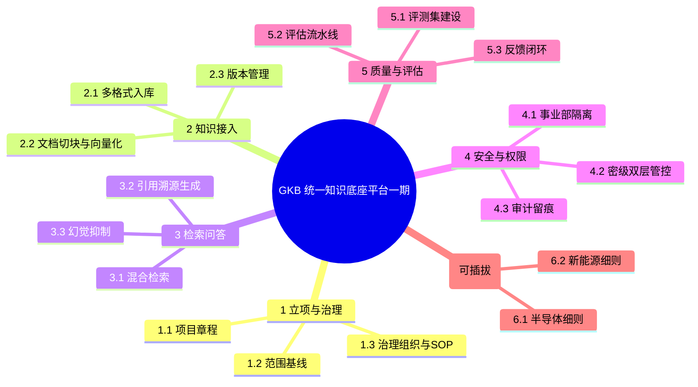
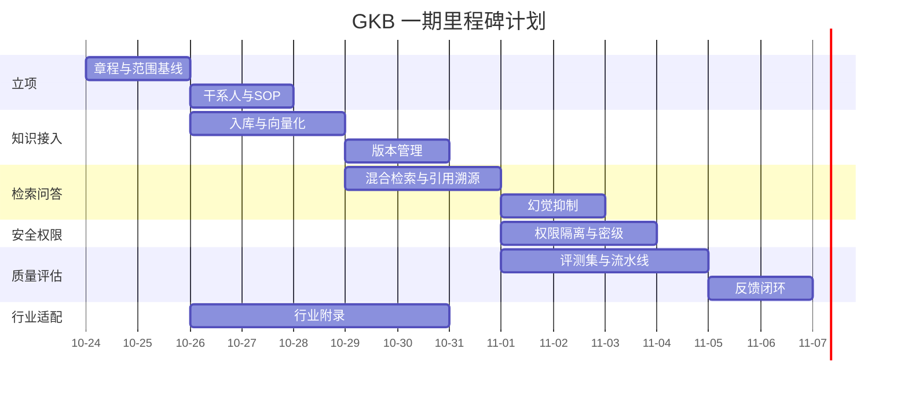

# WBS 拆解与里程碑计划（WBS & Milestone）

> 项目代号：GKB · 关联：`scope-statement.md`（范围）/ `feishu-wbs-import.csv`（可导入飞书的细粒度任务清单）
> WBS 遵循 100% 原则：下层工作包之和 = 上层交付物，无遗漏、无重叠。

## 1. WBS 树状图（三级）

## 2. WBS 逐级拆解表

| WBS | 工作包 | 交付物 | 责任 | 依赖 |
|---|---|---|---|---|
| 1.1 | 项目章程 | `project-charter.md` | PMO | — |
| 1.2 | 范围基线 | `scope-statement.md` | PMO | 1.1 |
| 1.3 | 治理组织与 SOP | `knowledge-governance-sop.md` | PMO + 各事业部 | 1.1 |
| 2.1 | 多格式入库 | 入库流水线 + 入库成功率报告 | 技术 | 1.2 |
| 2.2 | 切块与向量化 | 切块配置 + 向量索引 | 技术 | 2.1 |
| 2.3 | 版本管理 | 版本回溯能力 | 技术 | 2.1 |
| 3.1 | 混合检索 | 检索服务 | 技术 | 2.2 |
| 3.2 | 引用溯源生成 | 带引用回答 | 技术 | 3.1 |
| 3.3 | 幻觉抑制 | 拒答策略 | 技术 | 3.1 |
| 4.1 | 事业部隔离 | 权限过滤器 | 技术 + 信息安全 | 3.1 |
| 4.2 | 密级双层管控 | 密级模型 | 信息安全/法务 | 4.1 |
| 4.3 | 审计留痕 | 审计日志 | 技术 | 4.1 |
| 5.1 | 评测集建设 | 标注评测集 | PMO + 业务 | 3.2 |
| 5.2 | 评估流水线 | `evaluation-plan.md` 落地 | 技术 | 5.1 |
| 5.3 | 反馈闭环 | 反馈台账 + 流程 | PMO | 3.2 |
| 6.1/6.2 | 行业细则 | `industry-appendix.md` | PMO | 1.2 |

## 3. 里程碑时间线（Gantt）

## 4. 关键里程碑清单

| 里程碑 | 时间 | 验收门槛 |
|---|---|---|
| M1 立项基线完成 | Day1–2 | 章程 + 范围 + 干系人基线化 |
| M3 知识入库打通 | Day3–5 | 5 类格式入库成功率 ≥99% |
| M5 检索问答可用 | Day6–8 | 回答 100% 带引用来源 |
| M7 权限隔离上线 | Day9–11 | 越权访问率 = 0 |
| M8 评估体系就绪 | Day10–13 | 评估流水线可跑、指标固化 |
| M9 反馈闭环上线 | Day13–14 | 闭环率 ≥95% |

> 注：以上为**示意里程碑节奏**；`feishu-wbs-import.csv` 中的任务按「项目总周期 4 天、每日 4~5 小时」排布，是本作品集文档的**实际生产计划**，两者口径不同、互不冲突。

## 5. WBS 管理规则

- **100% 原则**：任何交付物都能在 WBS 树中找到唯一归属。
- **工作包粒度**：控制在「可独立验收、1 个责任主体、可估算」的最小单元。
- **变更即基线**：WBS 变更与范围变更绑定，走 CCB 流程。
